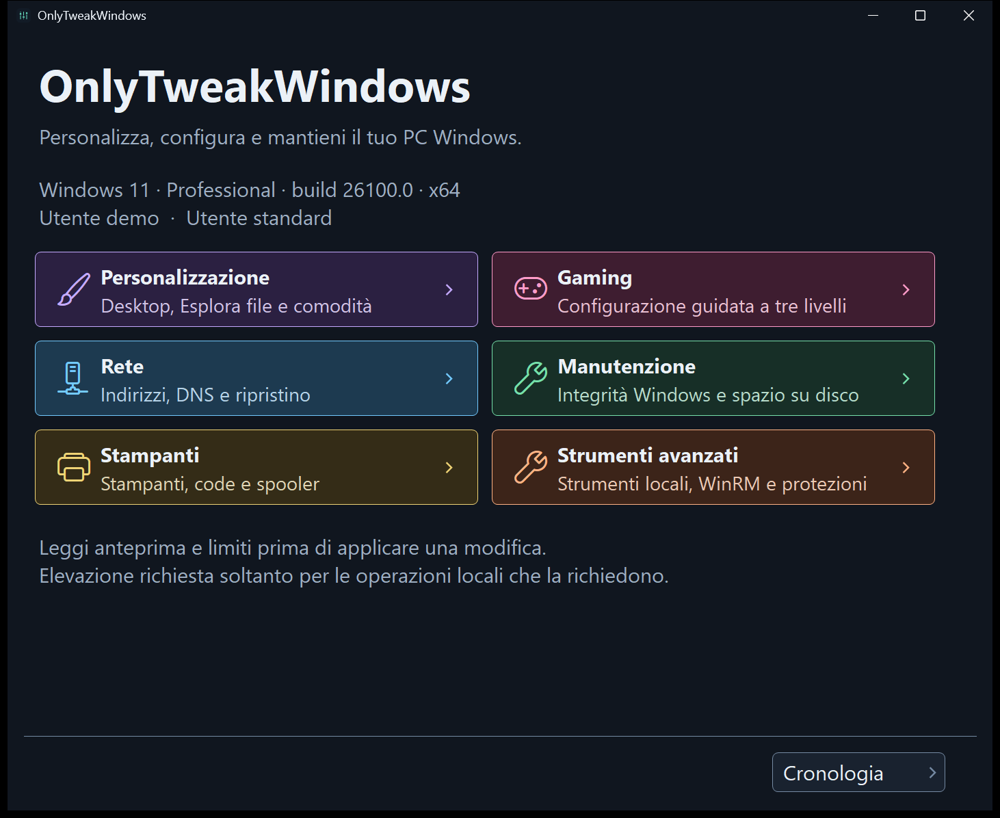

# OnlyTweakWindows

OnlyTweakWindows is a portable utility for personal Windows PCs. Use its Italian interface to personalize the desktop and File Explorer, review gaming settings, diagnose network problems, and manage local maintenance and printing.



See [more screenshots and capture details](docs/UI-UX.md#screenshots).

## Quick start

1. Check the [build requirements](#build-and-test). From the repository root, run `build.cmd` in Command Prompt.
2. Open `dist/OnlyTweakWindows.exe` from File Explorer. The executable includes the .NET runtime. You can open the main window as a standard user.
3. Open **Personalizzazione**, find **Questo PC**, and read the current state of the desktop icon. **Fonte e dettagli** explains the setting without changing it.
4. To change the icon, choose **Applica · Mostra icona** or **Applica · Nascondi icona** and review the confirmation. Use **Ripristina precedente** to recover the saved configuration when a valid checkpoint is available.

## Common tasks

- **Personalizzazione:** show/hide This PC, Recycle Bin, Network, User Files and Control Panel independently; Windows 11 classic context menu; extensions, hidden files, Explorer start page, selection checkboxes and full title-bar path.
- **Comodità:** guided clipboard history, Windows suggestions and app notifications. Cloud clipboard synchronization is never enabled automatically.
- **Mantieni sveglio:** choose 15 minutes to 8 hours and optionally keep the display on. The temporary request ends at expiry or app exit without changing the power plan.
- **Gaming:** three cumulative levels, with each action selected individually. Base covers Game Mode, background recording, display refresh and drivers. Balanced adds reversible animation reduction, existing power-plan selection and startup-app review. Advanced guides per-game GPU, windowed-game optimizations, HAGS and VRR when available.
- **Rete:** configuration, ping, DNS A/AAAA/CNAME, TCP port tests, connections, routes, proxy and explicit network resets.
- **Manutenzione / Stampanti:** Windows tools, SFC/DISM, storage settings, printer queues and spooler operations.
- **Strumenti avanzati:** local Windows tools, read-only protection information and local PowerShell Remoting / WinRM enablement.

See the [user guide](docs/GUIDE.md) for the steps and recovery options for each area.

## Configuration and data

Local audit files and recovery checkpoints live under `%LOCALAPPDATA%\OnlyTweak`. WinRM uses a separate recovery folder under `%PROGRAMDATA%\OnlyTweak\LocalRemoting`, restricted to administrators and SYSTEM.

OnlyTweak runs a fixed set of local operations. Actions that need administrator rights run in a separate elevated worker.

## Limits and recovery

- Registry and API rereads verify configuration, not every visible effect or gaming performance. No FPS improvement is guaranteed.
- The Windows 11 classic menu is an unofficial, build-dependent workaround. Explorer is not restarted automatically; sign-out may be needed.
- Restore stops on incomplete checkpoints, unexpected values or external configuration changes. Local audit is not immutable.
- Power plans may affect battery life, heat and fan noise. Only plans already available on the PC can be selected.
- Spool cleanup permanently removes all local print jobs, including other users' jobs. Network resets may interrupt connectivity and need a manual reboot. An SFC/DISM exit code alone does not prove repair.
- See the [WinRM guide](docs/GUIDE.md#local-powershell-remoting--winrm) for receiver prerequisites and recovery limits.

## Compatibility

The startup check accepts Windows 10 build 17763+ and Windows 11 on native Intel/AMD x64. Server hosts, ARM64 and x86 are rejected. Individual controls are limited by Windows build and installed components; hardware-dependent graphics options remain guided checks. Technical startup compatibility does not establish OS servicing status or clean-VM qualification.

## Build and test

Build on Windows x64 with a stable .NET 10 SDK compatible with [global.json](global.json), PowerShell 7.4 or later (`pwsh` on PATH), and NuGet access. Keep Windows PowerShell 5.1 available for the test fixtures and the app's PowerShell-backed operations.

Run from the repository root in Command Prompt:

```bat
build.cmd
test.cmd --artifact --ui --read-only --render
```

The build writes `dist/OnlyTweakWindows.exe` and a receipt with hashes at `artifacts/build-evidence/publish.json`. Run the build before `--artifact`, which checks the local bundle. `--ui` and `--render` need an interactive desktop. `--read-only` adds host reads to the synthetic fixtures. See the [UI guide](docs/UI-UX.md#qualification) for what the checks cover and which tests require dedicated machines.

For any permitted redistribution, keep the companion LICENSE, CREDITS.md, NOTICE.md and `licenses/` directory with the executable. Build and local delivery include them; the executable alone is not the complete redistribution package. [CREDITS](CREDITS.md) records the component licenses and Windows-runtime terms requiring owner/legal review.

Build, test and render outputs stay in `dist/` and `artifacts/`. Both projects use locked NuGet restore. A dependency mismatch fails the restore. When deliberately updating dependencies, run `dotnet restore OnlyTweakWindows.csproj -p:RestoreLockedMode=false` or `dotnet restore tests/OnlyTweakWindows.Tests.csproj -p:RestoreLockedMode=false`, then review the resulting lockfile diff and run the build and tests again.

Prepare a local delivery bundle after a successful build:

```powershell
pwsh -NoProfile -File scripts/prepare-release.ps1
```

The command creates `artifacts/delivery/2.0.0/` locally. Its manifest records hashes, runtime and dependency versions, and Authenticode status. A fresh local build produces an unsigned bundle for lab evaluation. To use `-RequireSigned`, the embedded scripts and executable must have valid signatures. Changed build inputs or executable bytes invalidate the receipt.

## Help and documentation

- [User guide](docs/GUIDE.md)
- [Architecture and primary sources](docs/TECHNICAL.md)
- [UI behavior and qualification](docs/UI-UX.md)

For a reproducible issue, provide the Windows build, action and observed result. Remove personal names, addresses and other private data from shared evidence. Historical enterprise and Italian documents are retained as history, not current feature guides.

## Security and license

See [SECURITY.md](SECURITY.md) for vulnerability reporting and [LICENSE](LICENSE) for the proprietary, all-rights-reserved license. Third-party dependencies retain their own licenses.
