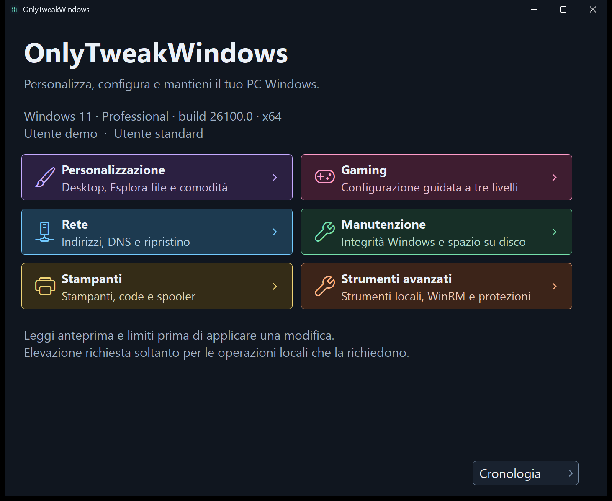

# OnlyTweakWindows



Portable utility for personal Windows PCs, with an Italian interface.

## Purpose

Personalize the desktop and File Explorer, review gaming settings, diagnose network problems and manage local maintenance and printing, with a restorable checkpoint before each change. It runs a fixed set of local operations; actions that need administrator rights run in a separate elevated worker.

## Requirements

- Windows 10 build 17763+ or Windows 11 on native Intel/AMD x64 (servers, ARM64 and x86 are rejected).
- To build: a stable .NET 10 SDK compatible with [global.json](global.json), PowerShell 7.4+ (`pwsh`), NuGet access, and Windows PowerShell 5.1 for the test fixtures.

## First setup

1. From the repository root, run `build.cmd` in Command Prompt.
2. Open `dist/OnlyTweakWindows.exe`: it includes the .NET runtime and starts as a standard user.
3. In **Personalizzazione**, read the state of **Questo PC**; **Dettagli** explains a setting without changing it.

## Usage

- Choose an option and select **Applica**; review the confirmation. **Ripristina precedente** restores a valid checkpoint.
- Areas: **Personalizzazione**, **Comodità**, **Mantieni sveglio**, **Gaming**, **Rete**, **Manutenzione / Stampanti**, **Strumenti avanzati**.
- Audit files and checkpoints live in `%LOCALAPPDATA%\OnlyTweak`. Some actions are not reversible (spool cleanup removes all local print jobs; network resets may interrupt connectivity), and no FPS gain is guaranteed.

## Build and test

```bat
build.cmd
test.cmd --artifact --ui --read-only --render
```

Run the build before `--artifact`; `--ui` and `--render` need an interactive desktop. Keep LICENSE, CREDITS.md, NOTICE.md and `licenses/` with the executable in any permitted redistribution. NuGet restore is locked: update the lockfile deliberately.

## Documentation and security

[User guide](docs/GUIDE.md) · [Technical notes](docs/TECHNICAL.md) · [UI and qualification](docs/UI-UX.md) · [Security policy](SECURITY.md) · [License](LICENSE) (proprietary, all rights reserved; [CREDITS](CREDITS.md)).
