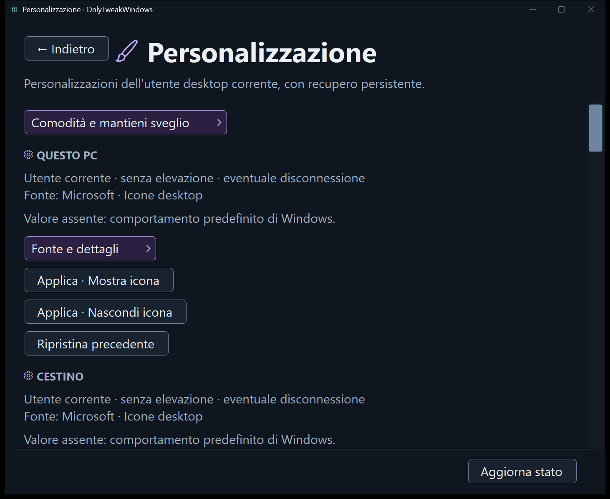
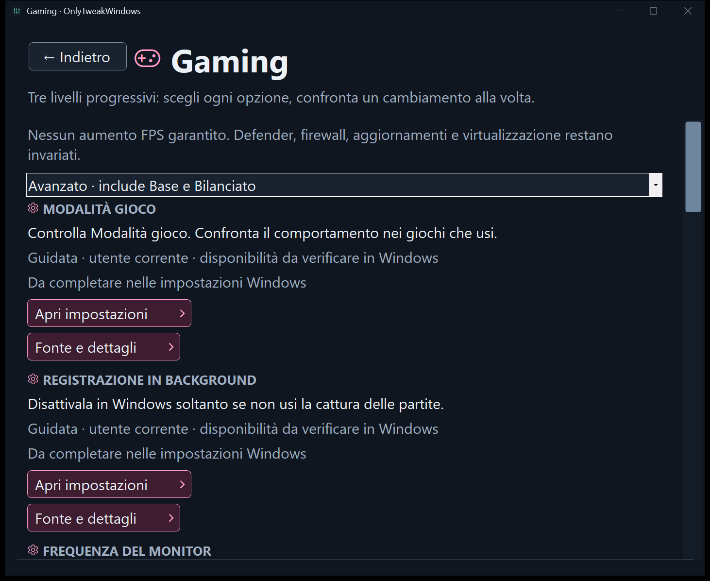

# UI behavior and qualification

The Windows Forms app uses one window with internal pages. Home exposes Personalizzazione, Gaming, Rete, Manutenzione, Stampanti and Strumenti avanzati. The established dark palette, typography, native dialogs and keyboard navigation are retained.

## Screenshots

These screenshots show the Italian, dark Windows Forms interface of OnlyTweakWindows 2.0.0, captured on 14 November 2026. The render harness opened the actual application windows with a synthetic Windows 11 profile, a demo account and simulated 150% scaling. Each PNG is 1462 × 1196 pixels.

- [Home](../assets/screenshots/home.png) shows the six areas and the session history button. The image is embedded in the [README](../README.md).
- Personalization shows the current state and the controls for showing, hiding or restoring the This PC desktop icon.

  

- Gaming shows the Advanced selection, which includes the Base and Balanced checklists. The scrollable page opens with Game Mode and background recording.

  

## Area colors and navigation

Each home entry has a dark colored surface, coordinated icon and border, and a directional chevron. Personalizzazione uses violet, Gaming pink, Rete blue, Manutenzione green, Stampanti gold and Strumenti avanzati orange. Labels and distinct icons identify areas independently of color. The repeated app eyebrow has been removed to give content more space.

Area identity is explicit, independent of translated titles, and follows internal navigation into details, diagnostic parameters and operations. Comodità and Mantieni sveglio belong to Personalizzazione; Spooler belongs to Stampanti; WinRM and Protezioni belong to Strumenti avanzati. Session history is neutral. Back restores the previous page and its colors without recreating its controls. Dynamically added gaming controls receive the same palette.

Navigation buttons retain their area color during hover and press, with a visible keyboard focus indicator. Disabled controls use neutral surfaces. Primary execution buttons retain their separate emphasis; warnings and confirmations retain their warning color and explicit text. Area color does not represent success, failure or safety.

The home grid switches to one column when the available width is below 760 logical pixels (scaled with the font), allowing scrolling at the minimum window size. Card heights account for icon space, the chevron and wrapped descriptions. Existing actions and navigation paths are preserved.

## State and confirmation

**Indietro** or **Alt+Left** returns to the earlier page and preserves its controls and results. Leaving an active diagnostic requests cancellation and waits for it to finish. A modifying action must finish before you can leave it. **Annulla** is the default action on a confirmation page.

Personalization offers explicit apply/show/hide choices and restore, with state, scope and recovery warnings. The desktop settings are independent and recover their compound values together. Gaming levels are cumulative checklists with per-action controls; guided settings remain incomplete, even after opening Windows. Hardware-dependent features are checked in Windows rather than inferred as available.

Keep-awake shows active/inactive/error and expiry. Its request survives page navigation and ends when the app closes. WinRM starts in an unverified state and never changes configuration on page entry. Verification and modifications require the local elevated worker.

## Qualification

UI tests use the Windows Forms message loop with synthetic identities, registry values, power plans and network interfaces. The render harness captures the home page, settings pages, confirmation and operation pages at simulated 100%, 150% and 200% scaling.

Area checks cover inheritance, dynamic controls, neutral history, confirmation colors, disabled states and keyboard reachability at the minimum window size. Computed contrast checks require 4.5:1 for normal text and 3:1 for icons and focus indicators across normal, hover and pressed area surfaces. The minimum secondary-text contrast across the palettes is 6.16:1. Minimum-size home captures include both the start and end of the scroll area.

Render runs use a stable SystemAware DPI context and scale the host window and fonts together. The production app and test runs without render flags use PerMonitorV2. To exercise UI checks in that mode, omit `--render` from the [test command](../README.md#build-and-test).

The current checks do not establish clean-VM behavior of real desktop changes, power/animation writes, firewall rules or external WinRM authentication. Those changes must be qualified on dedicated Windows 10/11 machines. Historical Italian notes and retired enterprise captures describe previous revisions only.
